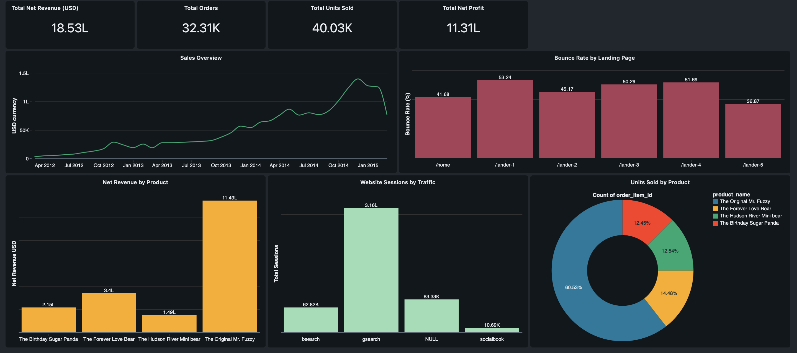

# E-Commerce Lakehouse Analytics Pipeline

**End-to-End Data Engineering & Analytics Project using Databricks, PySpark, SQL, and Delta Lake**

## Project Overview

This project demonstrates the development of an end-to-end E-Commerce Lakehouse Analytics Pipeline using Databricks.

The objective is to transform raw e-commerce data into clean, structured, and analytics-ready datasets using the **Medallion Architecture (Bronze, Silver, and Gold layers)**.

The project covers data ingestion, transformation, data quality validation, incremental processing, historical data tracking, Delta Lake optimization, and business intelligence reporting.

An interactive **Databricks AI/BI Dashboard** was developed using Gold-layer tables to analyze sales performance, profitability, product trends, and website traffic.

## Tech Stack

| Technology | Purpose |
|---|---|
| Databricks | Data engineering and analytics platform |
| PySpark | Data ingestion, cleaning, and transformation |
| SQL | Data querying, aggregations, and analysis |
| Delta Lake | Reliable data storage and table management |
| Unity Catalog | Data organization and governance |
| Databricks AI/BI | Interactive dashboard and reporting |
| Git & GitHub | Version control and project documentation |

## Dataset

This project uses the **Maven Analytics Toy Store E-Commerce Dataset**, containing:

- Website Sessions
- Website Pageviews
- Orders
- Order Items
- Products
- Order Item Refunds

**Dataset source:** [Link](https://mavenanalytics.io/data-playground/toy-store-e-commerce-database)

The raw dataset is not included in this repository. Download the dataset from the source and upload the files to a Databricks Unity Catalog Volume before executing the notebooks.

## Data Pipeline Architecture

The pipeline follows the **Medallion Architecture**, organizing data into three layers.

```text
          E-Commerce Dataset
                  |
                  v
       Unity Catalog Volume
                  |
                  v
        BRONZE LAYER
        Raw Data Ingestion
                  |
                  v
        SILVER LAYER
        Data Cleaning
        Data Transformation
                  |
                  v
         GOLD LAYER
         Business Aggregations
         Analytics-Ready Tables
                  |
                  v
        Databricks AI/BI
        Analytics Dashboard
```

### Bronze Layer — Data Ingestion

- Ingests raw e-commerce data into Databricks.
- Uses PySpark to read source files.
- Stores ingested records in Delta tables.
- Preserves source data for downstream processing.

### Silver Layer — Data Transformation

- Cleans and transforms raw data using PySpark.
- Handles missing values and duplicate records.
- Applies appropriate data types and transformations.
- Prepares structured datasets for business analysis.

### Gold Layer — Business Analytics

- Creates analytics-ready tables from transformed data.
- Uses SQL and aggregations to calculate business metrics.
- Supports analysis of revenue, orders, products, profitability, and website traffic.
- Serves as the data source for the Databricks AI/BI dashboard.

## Key Implementations

### 1. Data Quality Validation

Implemented data quality checks to assess the reliability and consistency of processed data.

Validation focuses on:

- Null and missing-value checks
- Duplicate record detection
- Data consistency
- Record-count validation

### 2. Incremental Data Ingestion

Developed an incremental ingestion workflow to practice processing newly arriving data.

The implementation includes test scenarios for:

- Normal incoming events
- Duplicate events
- Late-arriving events
- Events exceeding defined capacity

These scenarios help evaluate how the ingestion workflow handles different incoming data conditions.

### 3. Slowly Changing Dimensions (SCD Type 2)

Included an SCD Type 2 implementation to explore historical data tracking.

SCD Type 2 enables the preservation of previous dimension values when attributes change, rather than simply overwriting existing information.

### 4. Delta Lake Optimization

Explored Delta Lake optimization techniques for managing and maintaining Delta tables.

This component focuses on understanding how Delta Lake supports efficient data storage and processing.

## Analytics Dashboard

Developed an interactive **Databricks AI/BI Dashboard** using Gold-layer tables to visualize important e-commerce business metrics.

### Key Performance Indicators

- Total Net Revenue
- Total Orders
- Total Units Sold
- Total Net Profit

### Dashboard Visualizations

| Visualization | Business Purpose |
|---|---|
| Sales Overview | Analyze revenue trends over time |
| Net Revenue by Product | Compare product revenue contribution |
| Units Sold by Product | Understand product sales distribution |
| Website Sessions by Traffic Channel | Analyze website traffic sources |
| Bounce Rate by Landing Page | Evaluate landing-page engagement |

### Dashboard Preview



The dashboard provides a consolidated view of e-commerce performance, helping users explore sales trends, product performance, and website engagement.

## Project Structure

```text
E-Commerce-Lakehouse-Analytics-Pipeline/
|
|-- 00_project_setup.ipynb
|-- 01_bronze_ingestion.ipynb
|-- 02_silver_transformation.ipynb
|-- 03_gold_layer.ipynb
|-- 04_data_quality.ipynb
|-- 05_incremental_ingestion.ipynb
|-- 06_scd_type_2.ipynb
|-- 07_delta_optimization.ipynb
|
|-- images/
|   |-- dashboard.png
|
|-- README.md
```

### Notebook Descriptions

| Notebook | Description |
|---|---|
| 00_project_setup | Environment and project setup |
| 01_bronze_ingestion | Raw data ingestion into Bronze tables |
| 02_silver_transformation | Data cleaning and transformation |
| 03_gold_layer | Business-level aggregations |
| 04_data_quality | Data quality and validation checks |
| 05_incremental_ingestion | Incremental ingestion and test scenarios |
| 06_scd_type_2 | Historical dimension tracking |
| 07_delta_optimization | Delta Lake optimization practices |

## How to Run the Project

1. Set up a Databricks workspace with the required permissions.
2. Download the Maven Analytics Toy Store E-Commerce dataset.
3. Upload the source files to a Unity Catalog Volume.
4. Import the project notebooks into Databricks.
5. Update the catalog, schema, and file-path configurations as needed.
6. Execute the setup notebook.
7. Run the Bronze, Silver, and Gold notebooks in sequence.
8. Execute the data quality and advanced implementation notebooks.
9. Use the Gold-layer tables to recreate the Databricks AI/BI dashboard.

**Note:** The notebooks may require configuration changes depending on the Databricks workspace and source-data locations.

## Key Learnings

Through this project, I gained hands-on experience in:

- Designing a data pipeline using Medallion Architecture.
- Performing ETL transformations using PySpark and SQL.
- Working with Delta Lake tables in Databricks.
- Implementing data quality checks and validation.
- Understanding incremental ingestion and late-arriving data.
- Practicing SCD Type 2 for historical data management.
- Exploring Delta Lake optimization techniques.
- Building business intelligence dashboards using Databricks AI/BI.

## Conclusion

This project demonstrates how data engineering and analytics can be combined to transform raw e-commerce data into meaningful business insights.

It strengthened my practical understanding of building lakehouse pipelines, preparing reliable analytical datasets, and developing dashboards for data-driven decision-making.


